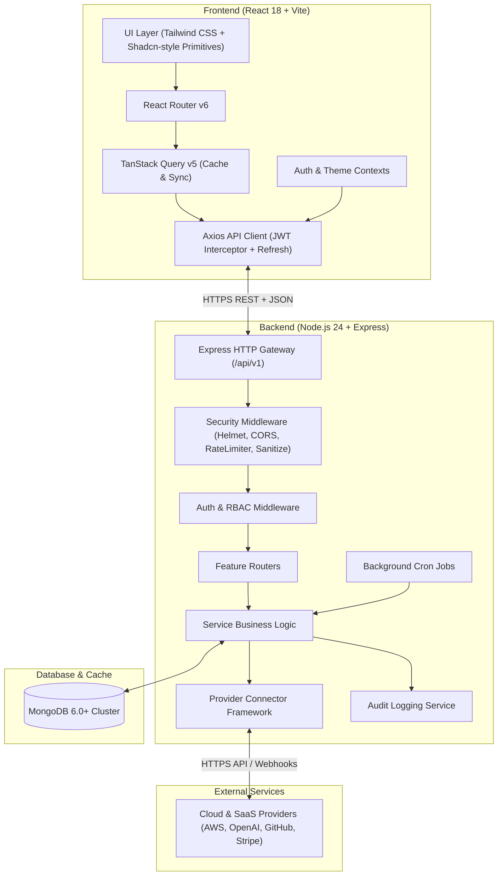
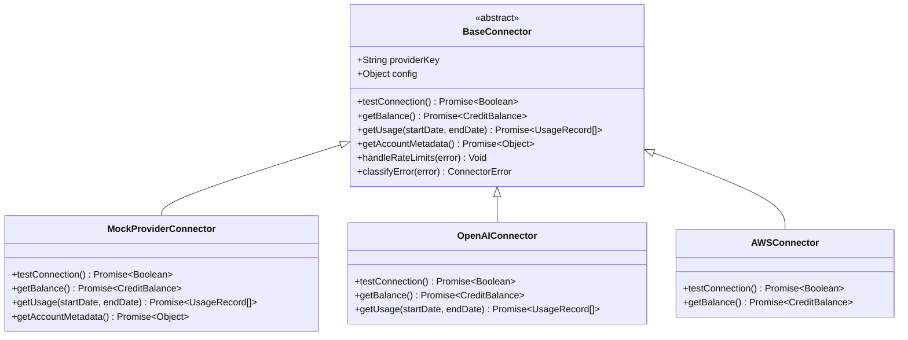

# ERSMS Architecture Document

## 1. System Overview

The **Enterprise Resource & Subscription Management System (ERSMS)** is an enterprise web application designed to govern digital resources, subscriptions, project-based resource allocations, API credit accounts, actual expenses, and automated notification workflows.

---

## 2. Layered Architecture Principles

### 2.1 Frontend Architecture
- **Feature-Based Modular Organization**: Each business domain (`auth`, `dashboard`, `resources`, `projects`, `allocations`, `subscriptions`, `api-credits`, `expenses`, `reports`, `users`, `notifications`, `settings`) lives in its own feature directory containing its components, hooks, and API query definitions.
- **Server State Management**: Server data is managed through TanStack Query, offering automatic cache invalidation, deduplication, retry policies, and optimistic updates.
- **Form State & Validation**: React Hook Form coupled with Zod resolvers delivers type-safe client-side validation mirroring backend constraints.
- **Design System & Accessibility**: Reusable, accessible UI components (buttons, badges, modals, data tables, alert dialogs) adhering to WCAG standards with instant dark/light theme switching via CSS variables.

### 2.2 Backend Architecture
- **Modular Monolith**: Organized into cohesive domain modules in `src/modules/` containing route definitions, controllers, Zod validation schemas, services, and Mongoose models.
- **Service Layer Pattern**: Controllers are lean handlers that validate inputs, invoke service methods, and serialize JSON responses. All transactional logic, integrity checks, cost calculations, and audit log generation reside in the service layer.
- **Financial Minor Units**: Monetary balances and costs are handled strictly as integer minor units (cents) with ISO 4217 currency identifiers, preventing IEEE 754 floating-point inaccuracies.
- **Asynchronous Audit Logging**: Critical lifecycle actions trigger non-blocking audit records capturing actor ID, IP address, user agent, target entity, action descriptor, and change diffs.

---

## 3. Provider Integration Framework

The connector framework provides an extensible, decoupled interface for communicating with third-party cloud and SaaS vendors.

- **Resilience**: Connectors encapsulate retry logic with exponential backoff and jitter, timeout limits, and standardized error classification (`AUTHENTICATION_ERROR`, `RATE_LIMIT_ERROR`, `QUOTA_EXCEEDED`, `NETWORK_ERROR`).
- **Safety**: Secret credentials are stored encrypted in the database or retrieved from environment variables; credentials are never transmitted to frontend clients.
