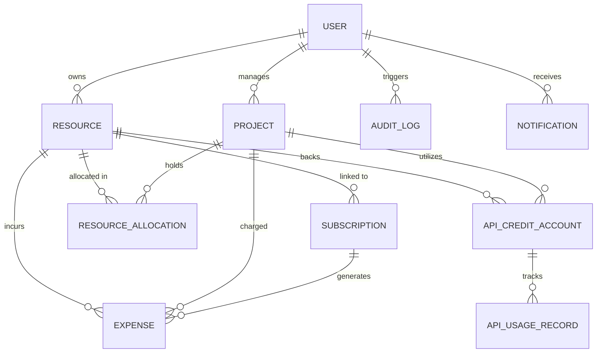

# ERSMS Database Design & Schema Specifications

## 1. Overview & Data Invariants

The persistence layer uses MongoDB with Mongoose ODM. Schemas are optimized for transactional integrity, strict validation, rapid indexing, and query performance.

### Invariants:
1. **Monetary Amounts**: Stored as integer cents (`costInCents`, `amountInCents`). Example: `$1,250.75` is stored as `125075`.
2. **Currency Consistency**: Every monetary entity explicitly stores an uppercase ISO 4217 code (`USD`, `EUR`, `GBP`, etc.).
3. **Soft Deletions**: Deletion operations on resources, projects, and subscriptions perform soft deletion (`isArchived: true` or `status: 'CANCELLED'`) to preserve financial and audit histories.
4. **Quota Models**: Quota models strictly discriminate between `MONETARY`, `REQUEST_QUOTA`, `TOKEN_QUOTA`, and `UNIT_QUOTA`.

---

## 2. Entity Relationship Diagram



---

## 3. Detailed Schema Definitions

### 3.1 Users (`users`)
- `_id`: ObjectId
- `name`: String (Required, trimmed)
- `email`: String (Required, unique, lowercase, indexed)
- `passwordHash`: String (Required, Argon2id/Bcrypt hash)
- `role`: Enum `['SUPER_ADMIN', 'ADMIN', 'PROJECT_MANAGER', 'EMPLOYEE']` (Default: `EMPLOYEE`, indexed)
- `department`: String (e.g., "Engineering", "Design", "DevOps")
- `isActive`: Boolean (Default: `true`, indexed)
- `refreshTokens`: Array of `{ tokenHash: String, expiresAt: Date, createdAt: Date, ipAddress: String, userAgent: String }`
- `createdAt`, `updatedAt`: Timestamps

### 3.2 Resources (`resources`)
- `_id`: ObjectId
- `name`: String (Required, indexed)
- `provider`: String (e.g., "AWS", "GitHub", "OpenAI", "Cloudflare", indexed)
- `category`: Enum `['CLOUD_INFRASTRUCTURE', 'SAAS_TOOL', 'DOMAIN_DNS', 'DEVELOPER_TOOL', 'SECURITY', 'OTHER']` (Indexed)
- `resourceType`: String (e.g., "Virtual Machine", "Repository Organization", "API Key", "SSL Certificate")
- `description`: String
- `ownerId`: ObjectId (Ref `User`, indexed)
- `department`: String (Indexed)
- `costInCents`: Number (Integer minor units, >= 0)
- `currency`: String (ISO 4217, default: "USD")
- `status`: Enum `['ACTIVE', 'INACTIVE', 'ARCHIVED', 'MAINTENANCE']` (Default: `ACTIVE`, indexed)
- `isArchived`: Boolean (Default: `false`, indexed)
- `renewalInfo`: `{ renewalType: 'AUTO' | 'MANUAL' | 'NONE', interval: 'MONTHLY' | 'QUARTERLY' | 'YEARLY' | 'CUSTOM' }`
- `notes`: String
- `createdAt`, `updatedAt`: Timestamps

### 3.3 Subscriptions (`subscriptions`)
- `_id`: ObjectId
- `name`: String (Required, indexed)
- `provider`: String (Required, indexed)
- `resourceId`: ObjectId (Ref `Resource`, indexed)
- `plan`: String (e.g., "Enterprise Tier", "Team 50 Seats")
- `startDate`: Date (Required)
- `billingFrequency`: Enum `['MONTHLY', 'QUARTERLY', 'YEARLY', 'ONE_TIME', 'CUSTOM']`
- `customIntervalDays`: Number (Optional)
- `nextRenewalDate`: Date (Indexed for cron reminders)
- `costInCents`: Number (Required, >= 0)
- `currency`: String (Required, default: "USD")
- `autoRenew`: Boolean (Default: `true`)
- `status`: Enum `['ACTIVE', 'TRIAL', 'PENDING_RENEWAL', 'EXPIRED', 'CANCELLED']` (Default: `ACTIVE`, indexed)
- `responsibleEmployeeId`: ObjectId (Ref `User`, indexed)
- `renewalReminders`: Array of `{ daysBefore: Number, sentAt: Date, notificationId: ObjectId }`
- `billingHistory`: Array of `{ billingDate: Date, amountInCents: Number, currency: String, invoiceRef: String, status: String }`
- `cancellationDetails`: `{ cancelledAt: Date, cancelledBy: ObjectId, reason: String }`
- `createdAt`, `updatedAt`: Timestamps

### 3.4 Projects (`projects`)
- `_id`: ObjectId
- `name`: String (Required, indexed)
- `code`: String (Required, unique, uppercase, indexed)
- `description`: String
- `status`: Enum `['PLANNING', 'ACTIVE', 'ON_HOLD', 'COMPLETED', 'ARCHIVED']` (Default: `ACTIVE`, indexed)
- `startDate`: Date
- `targetEndDate`: Date
- `leadId`: ObjectId (Ref `User`, indexed)
- `department`: String
- `budgetInCents`: Number (>= 0)
- `currency`: String (Default: "USD")
- `createdAt`, `updatedAt`: Timestamps

### 3.5 Resource Allocations (`resource_allocations`)
- `_id`: ObjectId
- `resourceId`: ObjectId (Ref `Resource`, required, indexed)
- `projectId`: ObjectId (Ref `Project`, required, indexed)
- `assignedEmployeeId`: ObjectId (Ref `User`, optional, indexed)
- `allocationMethod`: Enum `['EQUAL', 'PERCENTAGE', 'FIXED_AMOUNT', 'USAGE_BASED']` (Required)
- `allocationValue`: Number (Percentage 0-100, or fixed cents, or weight)
- `calculatedCostInCents`: Number (Calculated portion of resource cost)
- `currency`: String (ISO 4217)
- `startDate`: Date (Required)
- `endDate`: Date (Optional)
- `status`: Enum `['ACTIVE', 'TERMINATED', 'EXPIRED']` (Default: `ACTIVE`, indexed)
- `usageLimit`: Number (Optional quota limit)
- `createdAt`, `updatedAt`: Timestamps

### 3.6 API Credit Accounts (`api_credit_accounts`)
- `_id`: ObjectId
- `provider`: String (Required, e.g., "OpenAI", "Anthropic", "Stripe", indexed)
- `accountIdentifier`: String (e.g., Organization ID / Project Key)
- `resourceId`: ObjectId (Ref `Resource`, optional, indexed)
- `projectId`: ObjectId (Ref `Project`, optional, indexed)
- `creditModel`: Enum `['MONETARY', 'REQUEST_QUOTA', 'TOKEN_QUOTA', 'UNIT_QUOTA']` (Required, indexed)
- `unit`: String (e.g., "USD_CENTS", "REQUESTS", "TOKENS", "CREDITS")
- `reportedBalance`: Number (Balance confirmed from provider, >= 0)
- `estimatedBalance`: Number (Locally tracked balance between syncs)
- `totalPurchased`: Number (Cumulative purchased credits)
- `thresholdLimit`: Number (Alert threshold, triggers notification when balance <= threshold)
- `lastSyncAt`: Date
- `syncStatus`: Enum `['SUCCESS', 'FAILED', 'NEVER_SYNCED', 'SYNCING']` (Default: `NEVER_SYNCED`)
- `lastSyncError`: String
- `resetDate`: Date (For monthly resetting quotas)
- `createdAt`, `updatedAt`: Timestamps

### 3.7 Expenses (`expenses`)
- `_id`: ObjectId
- `amountInCents`: Number (Required, integer cents, >= 0)
- `currency`: String (Required, ISO 4217, default: "USD")
- `paymentDate`: Date (Required, indexed)
- `provider`: String (Required, indexed)
- `resourceId`: ObjectId (Ref `Resource`, optional, indexed)
- `subscriptionId`: ObjectId (Ref `Subscription`, optional, indexed)
- `projectId`: ObjectId (Ref `Project`, optional, indexed)
- `category`: Enum `['INFRASTRUCTURE', 'SOFTWARE_LICENSE', 'API_CREDITS', 'CONSULTING', 'HARDWARE', 'OTHER']`
- `invoiceNumber`: String (Indexed)
- `paymentStatus`: Enum `['PAID', 'PENDING', 'FAILED', 'REFUNDED']` (Default: `PAID`, indexed)
- `paymentMethod`: String (e.g., "Corporate Credit Card", "Wire Transfer", "ACH")
- `notes`: String
- `createdBy`: ObjectId (Ref `User`, indexed)
- `isForecast`: Boolean (Default: `false` — ensures strict separation from forecasted costs)
- `createdAt`, `updatedAt`: Timestamps

### 3.8 Notifications (`notifications`)
- `_id`: ObjectId
- `recipientId`: ObjectId (Ref `User`, indexed)
- `type`: Enum `['RENEWAL_UPCOMING', 'SUBSCRIPTION_EXPIRED', 'LOW_API_CREDIT', 'SYNC_FAILED', 'RESOURCE_ALLOCATED', 'SYSTEM']`
- `title`: String (Required)
- `message`: String (Required)
- `severity`: Enum `['INFO', 'WARNING', 'CRITICAL']` (Default: `INFO`)
- `targetEntity`: `{ entityType: String, entityId: ObjectId }`
- `isRead`: Boolean (Default: `false`, indexed)
- `readAt`: Date
- `createdAt`: Date (Indexed)

### 3.9 Audit Logs (`audit_logs`)
- `_id`: ObjectId
- `actorId`: ObjectId (Ref `User`, indexed)
- `actorEmail`: String
- `actorRole`: String
- `action`: String (Required, e.g., "RESOURCE_CREATED", "SUBSCRIPTION_RENEWED", "EXPENSE_DELETED")
- `targetType`: String (e.g., "Resource", "Subscription", "Project", "Expense")
- `targetId`: ObjectId
- `outcome`: Enum `['SUCCESS', 'FAILURE']` (Default: `SUCCESS`)
- `details`: Object (Sanitized metadata, diffs)
- `ipAddress`: String
- `userAgent`: String
- `createdAt`: Date (Indexed for historical log queries)

---

## 4. Key Indexes & Performance Strategies

```javascript
// Subscriptions: Upcoming renewal lookup
SubscriptionSchema.index({ status: 1, nextRenewalDate: 1 });

// Expenses: Date range and category aggregations
ExpenseSchema.index({ paymentDate: -1, isForecast: 1 });
ExpenseSchema.index({ projectId: 1, paymentDate: -1 });
ExpenseSchema.index({ provider: 1, paymentDate: -1 });

// Resource Allocations: Active allocations by resource & project
ResourceAllocationSchema.index({ resourceId: 1, status: 1 });
ResourceAllocationSchema.index({ projectId: 1, status: 1 });

// API Credit Accounts: Low balance & sync monitoring
ApiCreditAccountSchema.index({ creditModel: 1, reportedBalance: 1, thresholdLimit: 1 });

// Audit Logs: Filterable by actor, action and timestamp
AuditLogSchema.index({ createdAt: -1 });
AuditLogSchema.index({ targetType: 1, targetId: 1, createdAt: -1 });
```

